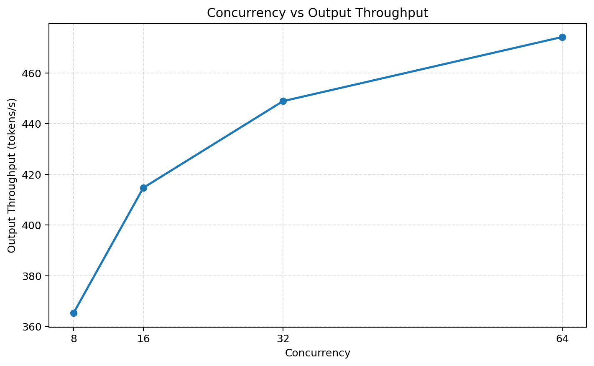
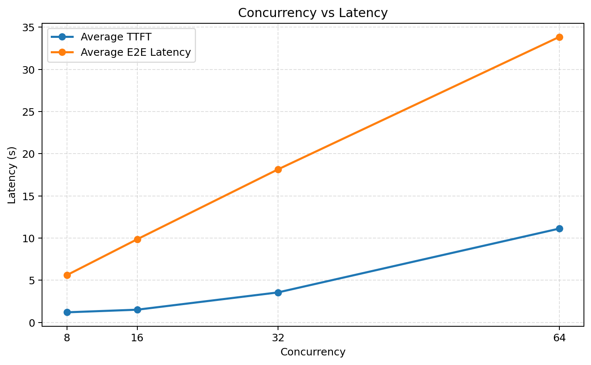
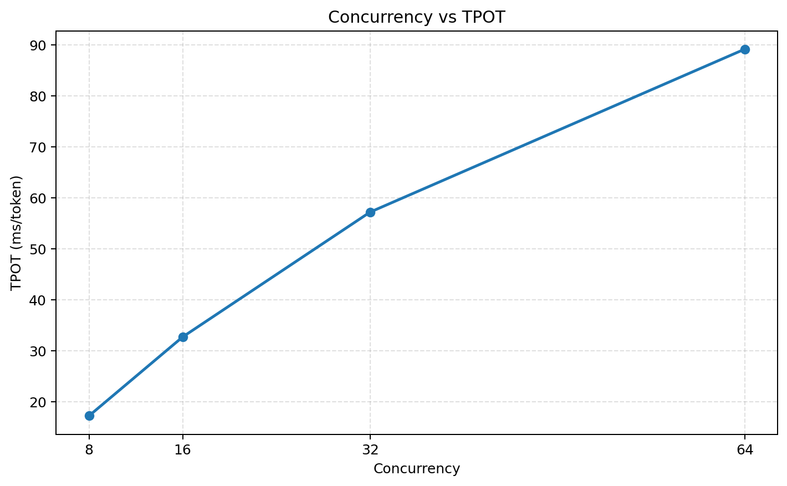
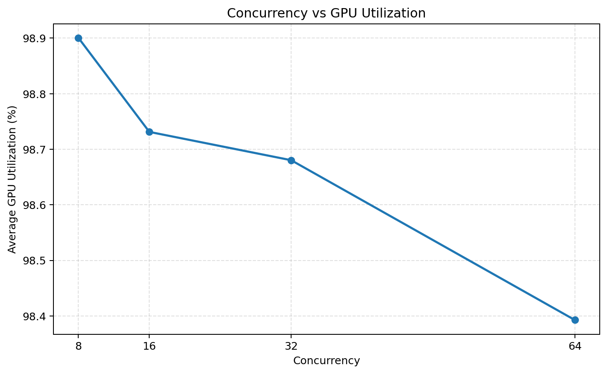
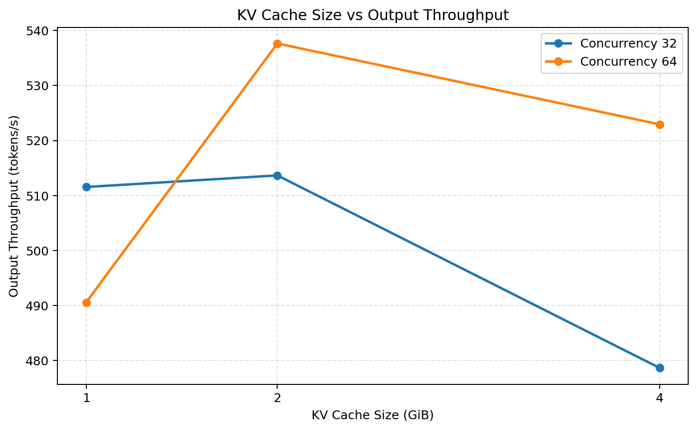
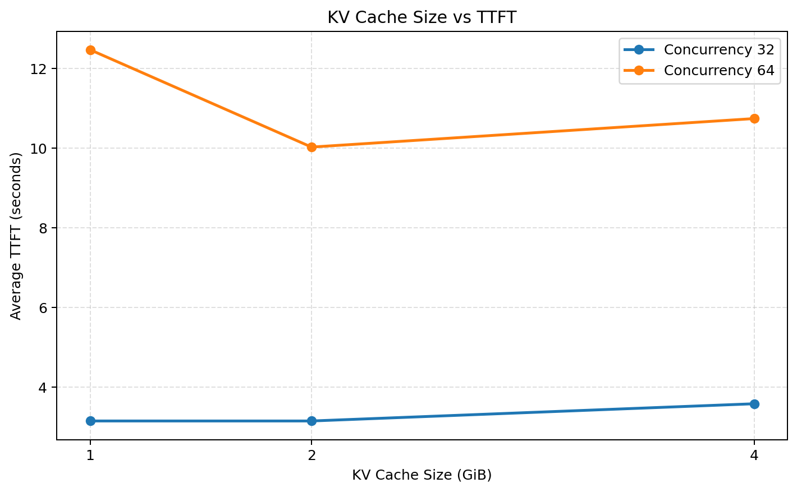
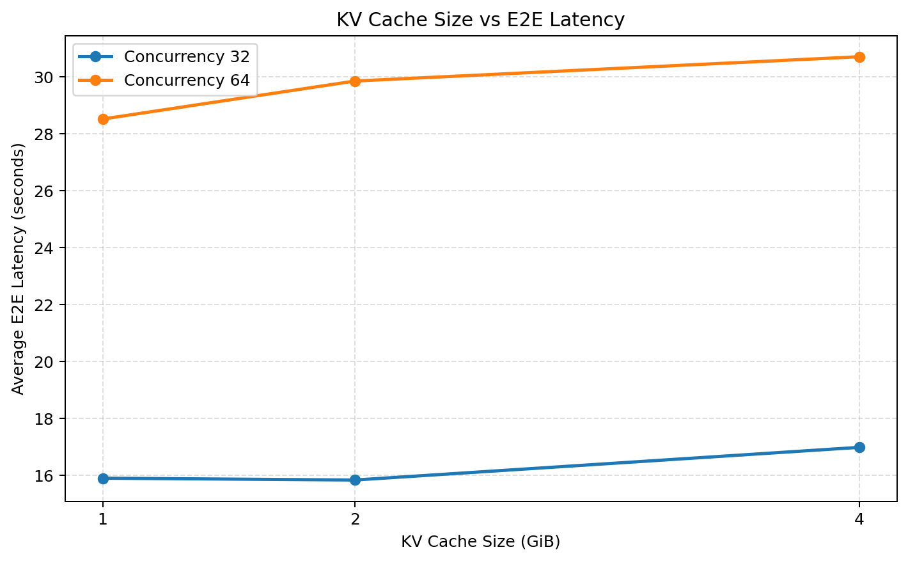
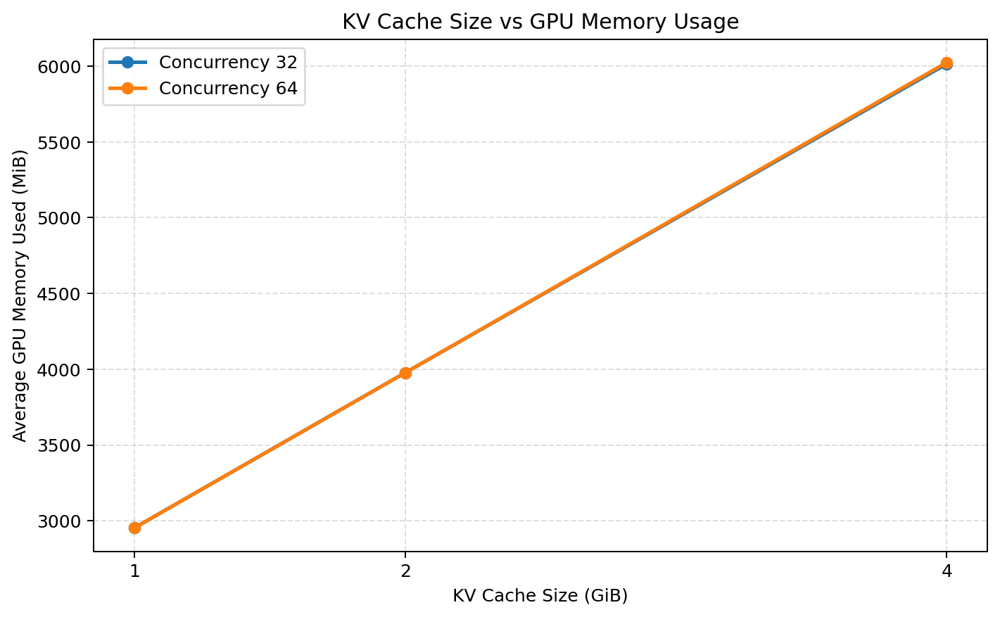

# vLLM 长上下文与 KV Cache 压力实验报告

> 实验项目：`llm_inference_benchmark`  
> 实验时间：2026-09-17 至 2026-09-18  
> 推理服务：vLLM OpenAI-compatible `/v1/chat/completions`  
> 模型：`Qwen/Qwen2.5-0.5B-Instruct`

## 1. 摘要

本实验研究两个问题：第一，随着并发度从 8 增加到 64，长上下文在线推理的吞吐和延迟如何变化；第二，将 vLLM 的 KV Cache 显式限制为 4、2、1 GiB 后，高并发请求是否出现容量压力。

实验经历了从短 prompt、单一长 prompt，到 64 个多样化长 prompt 和 clean restart 的逐步修正。这个过程揭示了一个非常重要的 benchmark 陷阱：**如果多个请求共享相同或高度相似的前缀，或者不同并发档位在同一个 vLLM 进程中连续执行，Prefix Cache 会污染后续结果，使 prefill 成本和 TTFT 被严重低估。** 最终实验因此采用 64 个从开头就不同的英文技术 prompt、`warmup_requests=0`，并在每个并发档位之间重启 vLLM。

最终 clean concurrency scaling 结果显示：并发从 8 增加到 64 时，输出吞吐从 365.3 增加到 474.2 tokens/s，仅增长约 29.8%；但平均 TTFT 从 1.20 秒增加到 11.12 秒，约为原来的 9.31 倍，平均 E2E latency 增加到原来的 6.04 倍。吞吐增益在 C16 之后迅速递减，C32→C64 只增加 5.64%，说明服务已经进入明显的饱和区。

显式 KV Cache 实验中，C32 在 1–4 GiB 之间没有呈现可信的单调退化；C64 则在 1 GiB 出现了最清晰的压力信号：相对 2 GiB，输出吞吐下降 8.75%，平均 TTFT 上升 24.36%，TTFT P95 上升 47.85%。所有请求仍然成功，因此 1 GiB 更接近“性能压力点”，尚未到达 OOM 或请求失败阈值。

需要特别说明的是，仓库没有保存对应轮次的完整 vLLM server log，因此无法从现有文件直接证明是否发生了 preemption 或 recompute。报告对调度行为的解释会明确标为假设，而不是事实。

## 2. Benchmark 实现与指标定义

客户端使用 `httpx.AsyncClient` 异步调用流式 Chat Completions API。总请求数由 `requests` 控制，同时执行的请求数由 `asyncio.Semaphore(concurrency)` 限制。每个并发档位的 wall time 覆盖整批正式请求，GPU 使用 `nvidia-smi --loop-ms=200` 独立采样。

核心指标定义如下：

- **TTFT（Time to First Token）**：从请求开始到收到第一个非空 `delta.content` 的时间。空 SSE event 不算首 token。
- **TPOT（Time per Output Token）**：`(total_latency - TTFT) / (completion_tokens - 1)`。第一个 token 的等待已计入 TTFT，因此解码阶段使用剩余的 `N-1` 个 token。
- **E2E latency**：请求开始到流完全结束的总耗时。
- **Request throughput**：成功请求数除以整批 benchmark wall time。
- **Output token throughput**：成功请求的 `completion_tokens` 总数除以整批 wall time。
- **P50/P95/P99**：对 request-level 指标进行线性插值统计。

token 数以 vLLM 在流式响应 `usage` 中返回的 `prompt_tokens` 和 `completion_tokens` 为准。`streamed_chunks` 只代表 SSE frame 数，不能当作 token 数，也不能用于计算 TPOT、ITL 或 tokens/s。

## 3. 实验参数及设置依据

| 参数 | 最终设置 | 设置原因 |
|---|---:|---|
| 模型 | Qwen2.5-0.5B-Instruct | 可以在 Kaggle 单卡环境稳定运行，又保留完整的 prefill、decode、调度和 KV Cache 路径。小模型也更容易把瓶颈推向 serving 系统。 |
| Prompt pool | 64 条 | 与正式请求数相同，每条请求使用一个不同 prompt，减少 Prefix Cache 重用。 |
| Prompt 长度 | 1,855–1,932 tokens | 约 1.9k token 的 prefill 能产生明显 KV 占用，同时给 256-token 输出留出上下文空间。 |
| Prompt 字符数 | 11,401–11,786 | 每篇为独立英文技术文本，前 300–500 tokens 避免共享固定模板。 |
| Requests | 64 | 每轮完整遍历一次 64 条 prompt pool；C64 时也可以一次形成 64 个在途请求。 |
| Concurrency | 8/16/32/64 | 覆盖中等负载、接近饱和和高排队压力区域。 |
| Max output tokens | 256 | 足够长，可以稳定观察 decode 阶段 TPOT 和输出吞吐，又不会让实验时间过长。 |
| Temperature | 0 | 减少生成随机性，使不同轮次更可比。 |
| Streaming | true | 必须通过流式响应才能严格测量首个非空 content 的到达时间。 |
| Warmup | 0（长上下文实验） | warmup 若使用正式 prompt pool，会提前写入 Prefix Cache，破坏 clean prefill 测量。普通 benchmark 的默认 warmup 不变。 |
| GPU 采样间隔 | 200 ms | 1 秒采样容易漏掉短时波动；200 ms 在时间分辨率和 `nvidia-smi` 开销之间折中。 |
| KV Cache | 4/2/1 GiB | 按 2 倍递减便于观察容量拐点；从 4 GiB 开始逐步施压，避免直接进入失败区。 |
| 服务重启 | 每个 clean 档位之间重启 | 清除 Prefix Cache 和上轮调度状态，使每个档位从相近初始状态开始。 |

vLLM 使用 `--dtype half --max-model-len 4096`。显式 KV Cache 轮次只设置 `--kv-cache-memory`，不再同时设置 `--gpu-memory-utilization`，避免两个容量控制变量混杂。

## 4. 实验演进与异常定位

### 4.1 短 prompt 基线：验证客户端稳定性

最早的 `run_1`、`run_2`、`run_3` 使用 128 个输出 token、warmup=5 和短 prompt。三次 C32 输出吞吐分别为 2562.7、2580.9、2591.6 tokens/s，均值为 2578.4 tokens/s，变异系数约 0.46%。

这说明异步客户端、wall-time throughput 和流式统计的重复性较好。但短 prompt 几乎不消耗大量 KV Cache，吞吐很高，无法回答长上下文容量问题。因此这组实验适合作为实现 sanity check，不适合作为 KV Cache 压力结论。

### 4.2 调整 `gpu-memory-utilization`：结果没有形成清晰梯度

随后比较了 `gpu_memory_utilization=0.5/0.7/0.9`。短 prompt 下各档吞吐和延迟几乎不变，C32 输出吞吐都在约 2552–2564 tokens/s。这个结果并不是“KV Cache 容量没有作用”，而是 workload 尚未把 KV Cache 推到压力区。

这一阶段还出现了 GPU memory 指标非单调的现象：0.5、0.7、0.9 轮次的 `nvidia-smi memory.used` 分别约为 7779、10761、9043 MiB。这里不能把 `memory.used` 直接等同于可用 KV Cache 容量；它是整个进程/设备的已用显存快照，还受到服务启动方式、运行时分配、进程残留和版本行为影响。由于当时未把完整 vLLM 启动日志一并保存，不能进一步归因。

### 4.3 单一长 prompt：Prefix Cache 让结果“好得不真实”

`long_context_gpu_mem_07` 将 prompt 增长到实际 1927 tokens，输出增长到 256 tokens，但所有请求使用同一 prompt，并执行了 5 个 warmup 请求。结果如下：

| Concurrency | Output tok/s | TTFT avg (s) | TPOT avg (ms/token) | E2E avg (s) |
|---:|---:|---:|---:|---:|
| 8 | 712.4 | 0.081 | 11.0 | 2.87 |
| 16 | 920.7 | 0.111 | 17.0 | 4.44 |
| 32 | 1098.5 | 0.175 | 28.4 | 7.42 |
| 64 | 1255.4 | 0.428 | 48.8 | 12.88 |

长达 1927 tokens 的输入却只有 81 ms 的 C8 平均 TTFT，这不是可代表真实冷前缀 workload 的结果。warmup 和重复 prompt 使前缀高度可复用，后续请求绕过了大部分 prefill 计算。这个异常推动了 prompt pool 的设计。

### 4.4 首次 prompt pool：不同并发档位之间仍有缓存污染

`long_context_pool_07` 使用 64 个不同 prompt，并把 warmup 设为 0，但 C8/C16/C32/C64 仍在同一个 vLLM 进程中依次运行。C8 的平均 TTFT 为 1.051 秒，而紧随其后的 C16 只有 0.098 秒，下降约 90.6%；随后 C32/C64 又上升到 0.169/0.446 秒。

这条曲线违反了正常的负载趋势，原因是 C8 已经遍历并缓存了相同的 64 条 prompt，C16 虽然没有自己的 warmup，却继承了前一档留下的 Prefix Cache。由此确认：**`warmup=0` 只能避免本档主动预热，不能清除服务进程此前积累的 cache。**

最终修正方案是：每个 concurrency 使用独立输出目录，并在每一档之前重启 vLLM。首次 pool 连跑的数据保留为实验设计纠错记录，不进入最终结论。

## 5. Clean Long-context Concurrency Scaling

最终 clean workload 使用 64 条多样化 prompt、64 个请求、256 个输出 token、warmup=0，并在每档之间重启服务。所有档位均为 64/64 成功，请求实际 prompt 长度为 1855–1932 tokens，completion 均为 256 tokens。

| Concurrency | Req/s | Output tok/s | TTFT avg (s) | TTFT P95 (s) | TTFT P99 (s) | TPOT avg (ms/token) | E2E avg (s) | GPU util avg |
|---:|---:|---:|---:|---:|---:|---:|---:|---:|
| 8 | 1.427 | 365.3 | 1.195 | 1.815 | 2.569 | 17.3 | 5.60 | 98.90% |
| 16 | 1.620 | 414.7 | 1.506 | 4.394 | 5.170 | 32.7 | 9.86 | 98.73% |
| 32 | 1.753 | 448.9 | 3.553 | 9.947 | 10.816 | 57.2 | 18.14 | 98.68% |
| 64 | 1.852 | 474.2 | 11.122 | 20.963 | 21.888 | 89.1 | 33.85 | 98.39% |

### 5.1 吞吐：边际收益快速递减

- C8→C16：输出吞吐增加 13.54%。
- C16→C32：增加 8.24%。
- C32→C64：只增加 5.64%。

C8 到 C64 的总吞吐仅增加 29.82%，而并发扩大了 8 倍。GPU 在 C8 时平均利用率已经达到 98.9%，后续提高 concurrency 主要增加等待和调度竞争，不能再成比例地增加计算利用率。

### 5.2 延迟：C32/C64 进入明显饱和区

C8→C64 时，平均 TTFT 增长 9.31 倍，平均 E2E latency 增长 6.04 倍。TTFT P95 在 C64 达到 20.96 秒，说明高并发下用户首先感受到的是长时间等待首 token，而不是单纯的 token 生成变慢。

TPOT 同样从 17.3 增长到 89.1 ms/token，增长 5.16 倍。这说明压力不仅发生在请求排队阶段，decode 批处理和 GPU 时间片竞争也显著降低了单请求生成速度。

### 5.3 GPU：高利用率不等于更好的服务质量

四个档位的平均 GPU utilization 都约为 98–99%，但吞吐逐渐变平、延迟急剧上升。这是服务系统中很典型的现象：硬件忙并不代表请求的服务质量好。GPU utilization 适合解释资源是否空闲，不能单独替代吞吐、TTFT 和尾延迟。

如果目标是交互式服务，C16 是更保守的工作点；如果更重视离线吞吐，可以考虑 C32。C64 为 5.64% 的额外吞吐付出了平均 TTFT 从 3.55 秒升至 11.12 秒的代价，不适合作为低延迟配置。

## 6. 显式 KV Cache 容量实验

KV Cache 实验使用相同的 prompt pool 和请求设置，只改变 `--kv-cache-memory`，并分别测试 C32 和 C64。每个 `(cache size, concurrency)` 组合前均重启 vLLM。六组实验均为 64/64 成功，输入 token 总数均为 121,388，输出 token 总数均为 16,384。

| KV Cache | C | Output tok/s | TTFT avg (s) | TTFT P95 (s) | TTFT P99 (s) | TPOT avg (ms/token) | E2E avg (s) | GPU mem avg (MiB) |
|---:|---:|---:|---:|---:|---:|---:|---:|---:|
| 4 GiB | 32 | 478.7 | 3.585 | 9.726 | 10.535 | 52.6 | 16.99 | 6015 |
| 4 GiB | 64 | 522.9 | 10.738 | 19.510 | 20.329 | 78.3 | 30.71 | 6025 |
| 2 GiB | 32 | 513.7 | 3.152 | 8.772 | 9.524 | 49.8 | 15.84 | 3977 |
| 2 GiB | 64 | 537.6 | 10.023 | 18.712 | 19.521 | 77.8 | 29.86 | 3977 |
| 1 GiB | 32 | 511.5 | 3.153 | 8.774 | 9.544 | 50.0 | 15.91 | 2953 |
| 1 GiB | 64 | 490.6 | 12.464 | 27.666 | 28.156 | 63.0 | 28.52 | 2953 |

### 6.1 吞吐结果

C32 下，2 GiB 和 1 GiB 几乎相同，并且单次结果反而高于 4 GiB。这不是“小 cache 更快”的充分证据。每个组合目前只有一轮，差异可能来自运行间波动、热状态或 scheduler 状态；在没有重复实验和 server log 的前提下，不应给它因果解释。

C64 下出现了更有意义的拐点：4→2 GiB 吞吐小幅增加 2.81%，但 2→1 GiB 吞吐下降 8.75%。这表明 1 GiB 在 64 个并发长上下文请求下开始形成容量压力。

### 6.2 TTFT 与尾延迟

C64 从 2 GiB 缩小到 1 GiB 后：

- 平均 TTFT 从 10.02 秒增加到 12.46 秒，上升 24.36%。
- TTFT P95 从 18.71 秒增加到 27.67 秒，上升 47.85%。
- TTFT P99 从 19.52 秒增加到 28.16 秒，上升 44.23%。

尾部 TTFT 比均值恶化得更明显，说明一部分请求等待首 token 的时间被显著拉长。这是当前数据中最可靠的 KV Cache 压力信号。

### 6.3 E2E/TPOT 的非单调现象

1 GiB C64 的平均 E2E latency（28.52 秒）和平均 TPOT（63.0 ms/token）反而低于 2 GiB C64（29.86 秒、77.8 ms/token），与此同时 TTFT 尾延迟明显变差。这个组合看似矛盾，但指标覆盖的是请求生命周期的不同阶段。

一种可能解释是：更紧的 KV 容量使部分请求在首 token 前等待更久，而真正进入 decode 的活跃请求批次更小，已获调度请求的 token 生成反而更快；因此 TTFT 尾部恶化，但 TPOT 下降。**这只是与数据一致的调度假设，不是已验证事实。** 要确认它，需要同轮 vLLM 日志中的 `Running`、`Waiting`、KV usage、preemption 和 recompute 记录，最好再结合每次请求的时间线。

### 6.4 GPU memory 验证

GPU 平均已用显存从约 6015 MiB（4 GiB cache）下降到 3977 MiB（2 GiB），再下降到 2953 MiB（1 GiB），档位差约符合显式 KV Cache 的变化，说明容量参数确实生效。需要注意，这里的 `memory.used` 是进程整体显存占用，不能直接当作实时 KV Cache usage。

## 7. 结论与边界

本实验可以支持以下结论：

1. benchmark 客户端在短 prompt C32 的三次运行中具有较好重复性，吞吐变异系数约 0.46%。
2. 对长上下文 workload，Prefix Cache 污染足以把 TTFT 降低一个数量级，必须控制 prompt 前缀、warmup 和服务重启。
3. clean workload 下，GPU 在 C8 已接近满载；C16 以后吞吐边际收益递减，C32/C64 的延迟代价快速扩大。
4. 对当前模型、prompt 长度和 64 请求 workload，C64 + 1 GiB 出现明显的 TTFT 尾延迟和吞吐退化，但尚未出现请求失败。
5. “更高 GPU utilization”或“更多 concurrency”都不能单独代表更好的 serving 配置，至少要联合观察 throughput、TTFT、TPOT 和尾延迟。

当前不能支持的结论：

- 不能仅凭一轮数据宣称 2 GiB 一定优于 4 GiB。
- 不能仅凭 request-side 指标断言已经发生 preemption/recompute。
- 不能把 `nvidia-smi memory.used` 当成 vLLM 内部 KV Cache 的实时占用率。
- 不能把本次绝对数值直接推广到其他 GPU、vLLM 版本、模型或 prompt 分布。

## 8. 后续实验建议

为了把这份结果升级为更严谨的性能研究，建议：

1. 每个 `(KV size, concurrency)` 至少运行 3–5 次，报告均值、标准差或置信区间。
2. 随机化 1/2/4 GiB 的执行顺序，降低温度和时间漂移与 cache size 的相关性。
3. 每轮保存 vLLM 启动参数、版本、GPU 型号、driver/CUDA 版本和完整 server log。
4. 从日志提取 Prefix Cache hit rate、Running、Waiting、KV usage、preemption 和 recompute，并用 benchmark UTC 边界对齐。
5. 在 1 GiB 附近增加 0.5/0.75/1.5 GiB 档位，定位真正的性能拐点和失败阈值。
6. 分开报告交互式 SLO（例如 TTFT P95）和批处理目标（tokens/s），不要用单一“最优并发”覆盖不同业务目标。

## 9. 如何吃透项目并用于面试

### 9.1 先能完整讲清一条请求

建议沿着以下路径读代码并自己画一次时序图：

1. `cli.py`：参数解析、prompt 优先级、warmup、逐并发运行、GPU monitor 生命周期和输出目录。
2. `client.py`：`httpx` 流式请求、SSE 解析、首个非空 content、usage 和错误处理。
3. `models.py`：request-level 数据模型、TPOT 公式和序列化。
4. `metrics.py`：成功请求过滤、percentile、wall-time throughput 和 token 汇总。
5. `gpu_monitor.py`：`subprocess.Popen`、200 ms 采样、优雅停止、CSV 解析与 GPU index 过滤。
6. `output.py`：每次请求 CSV/JSON、单档 summary 和 combined summary。
7. `scripts/plot_results.py` 与 `plot_kv_cache_results.py`：从结果 schema 到可复现图表。
8. `tests/`：没有 GPU、没有 `nvidia-smi`、空 SSE、无 usage、异常退出等边界如何被 mock 和验证。

读完以后，应该能不看代码回答：“请求从 CLI 进入后，何时开始计时、何时记录 TTFT、usage 从哪里来、失败请求为何不进入吞吐、GPU monitor 在异常时如何停止、结果最终落到哪些文件。”

### 9.2 必须真正理解的五个问题

**为什么 TTFT 不能使用第一个 SSE event？**  
OpenAI-compatible stream 可能先返回 role、空 content 或控制事件。只有第一个非空 generated content 才是用户真正看到的首 token。

**为什么 streamed chunk 不能当 token？**  
一个 SSE frame 可能包含零个、一个或多个 tokenizer token；网络分帧和模型 tokenization 不是同一层。token 数必须来自 API usage。

**为什么 TPOT 除以 `completion_tokens - 1`？**  
首 token 已经由 TTFT 覆盖；`total_latency - TTFT` 是首 token 之后的 decode 时间，对应剩余 N-1 个输出 token。

**为什么 throughput 要用整批 wall time？**  
线上系统关心单位真实时间完成多少工作。把每个请求 latency 相加会重复计算并行时间，不能代表系统吞吐。

**为什么 long-context 实验反而不用 warmup？**  
普通算力 benchmark 用 warmup 消除冷启动噪声是合理的；但本实验要测冷前缀 prefill 和 KV 压力，用正式 prompt warmup 会主动制造 Prefix Cache 命中。因此这里选择重启服务并 warmup=0，是 workload 目标决定的，而不是“warmup 永远不好”。

### 9.3 面试中最有价值的异常故事

不要只展示最终三张图。更有含金量的讲法是：

> 我最初用同一个约 2k-token prompt 做并发测试，TTFT 只有几十毫秒，明显不符合长 prefill 的直觉。我检查实验设计后发现 warmup 和重复前缀触发了 vLLM Prefix Cache。改成 64 条不同 prompt 后，第一次 C8 正常，但同进程后跑的 C16 又异常变快，说明不同并发档位之间仍有缓存污染。最终我把 warmup 设为 0，并在每个并发档位前重启 vLLM，才得到随并发上升而合理恶化的 clean 曲线。这个过程让我认识到 benchmark 不只是写并发请求，还要控制服务状态和 workload 分布。

这段经历同时体现了性能直觉、异常检测、控制变量、系统机制和工程修正，比单纯说“我写了个压测脚本”更有说服力。

### 9.4 建议亲手完成的练习

- 随机抽一条 `requests.json`，手算它的 TPOT，并与保存值核对。
- 从 64 条 raw result 重算 TTFT P95，解释线性插值的位置。
- 人为构造 role-only、空 content、usage-only SSE，确认 TTFT 不会被误记。
- mock `nvidia-smi` 不存在和进程异常退出，解释为什么 benchmark 仍能继续。
- 用同一组数据重新生成全部图片，确认图表不依赖硬编码并发度。
- 比较单 prompt、pool 连跑和 clean restart 三组数据，口头解释 Prefix Cache 污染链路。
- 给现有工具设计一个“重复 N 次并输出置信区间”的最小扩展方案，但先说明为什么不能破坏当前 raw output。

### 9.5 三分钟项目介绍模板

> 这是一个面向 OpenAI-compatible vLLM 服务的异步 benchmark client。它用 httpx streaming 严格测量第一个非空 content 的 TTFT，并基于服务返回的 usage 计算 TPOT 和 output token throughput，同时用独立 nvidia-smi 进程以 200 ms 采样 GPU。项目支持单 prompt、文件 prompt 和 JSONL prompt pool，能够避免把 SSE chunk 误当 token。  
>  
> 我用它研究了约 1.9k-token 输入、256-token 输出在不同并发度和 1/2/4 GiB KV Cache 下的行为。实验中最大的坑是 Prefix Cache 污染：重复 prompt、warmup 和同进程连续跑档位会让 TTFT 假性变好。我最终采用 64 个多样化前缀、warmup=0、每档重启服务。clean 结果显示 C32→C64 吞吐只提高 5.6%，但平均 TTFT 从 3.55 秒升到 11.12 秒；在 C64 下把 KV Cache 从 2 GiB 降到 1 GiB，吞吐下降 8.75%，TTFT P95 上升 47.85%。这说明服务已经越过吞吐收益明显的并发拐点，并开始受到 KV 容量约束。  
>  
> 我也保留了 raw request、summary、GPU CSV 和绘图脚本，并通过 mock 测试保证没有 NVIDIA GPU 时客户端也不会崩溃。下一步会做多轮重复和对齐 vLLM server log，以验证 preemption/recompute，而不会仅凭客户端指标过度归因。

## 10. 结果文件索引

- Clean concurrency：`results/long_clean_c8`、`long_clean_c16`、`long_clean_c32`、`long_clean_c64`
- 显式 KV Cache：`results/kv4g_c32`、`kv4g_c64`、`kv2g_c32`、`kv2g_c64`、`kv1g_c32`、`kv1g_c64`
- Concurrency 图：`results/concurrency_plots/`
- KV Cache 图：`results/kv_plots/`
- 中间异常实验：`results/long_context_gpu_mem_07`、`results/long_context_pool_07`
- 早期重复性实验：`results/run_1`、`run_2`、`run_3`

本报告中的数值均来自仓库内保存的 `combined_summary.json`；未保存的 GPU 型号、vLLM 版本和 server-side preemption/recompute 状态没有被推测性补全。
